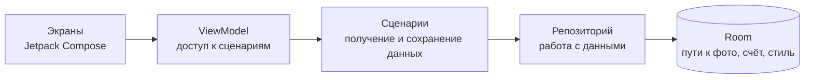

<div align="center">

# Find The Parent

**Игра на память с фотографиями родителей**


[Скриншоты](#скриншоты) · [Как играть](#как-играть) · [Архитектура](#архитектура) · [Сборка](#сборка) · [Статус](#статус)

</div>

Личная Android-игра, которую я самостоятельно разработал для дочери на Kotlin и Jetpack Compose. Ребёнок открывает карточки с животными и ищет парные фотографии родителей. Вместо готовых персонажей можно выбрать собственные снимки с телефона.

## Скриншоты

<table>
  <tr>
    <th width="33%">Главный экран</th>
    <th width="33%">Выбор режима</th>
    <th width="33%">Игровое поле</th>
  </tr>
  <tr>
    <td align="center"><a href="https://github.com/user-attachments/assets/b0e18c91-ed58-44d9-9367-0f9ee70dd916"></a></td>
    <td align="center"><a href="https://github.com/user-attachments/assets/4559d113-e17b-45e9-807c-1c5647b97acd"></a></td>
    <td align="center"><a href="https://github.com/user-attachments/assets/12bcb5ad-65c3-4766-a1d7-87fb4ea00be3"></a></td>
  </tr>
</table>

<details>
<summary>Дополнительные экраны</summary>

<table>
  <tr>
    <th width="50%">Заставка</th>
    <th width="50%">Панель настроек</th>
  </tr>
  <tr>
    <td align="center"><a href="https://github.com/user-attachments/assets/b008d516-5eeb-4c27-9418-83323b184d38"></a></td>
    <td align="center"><a href="https://github.com/user-attachments/assets/9485f1bd-dd7f-4ae7-a134-1339d212bb64"></a></td>
  </tr>
  <tr>
    <th>Вариант экрана выбора</th>
    <th>Поиск пар</th>
  </tr>
  <tr>
    <td align="center"><a href="https://github.com/user-attachments/assets/16d0f6f5-7b62-435d-b663-51d10d60a29e"></a></td>
    <td align="center"><a href="https://github.com/user-attachments/assets/7bc787fb-c5d8-42e2-aa7e-4955a965fe77"></a></td>
  </tr>
</table>

</details>

## Как играть

1. На главном экране выбрать фотографии родителей и нажать «Начать».
2. Выбрать режим и открывать карточки по две: совпавшие остаются открытыми, остальные закрываются.
3. В обычных режимах найти пару с фотографией родителя, чтобы завершить раунд. В Special — собрать все пары животных.

| Режим | Карточки | Поле | Задача |
| --- | ---: | --- | --- |
| Easy | 12 | 3 колонки | Найти пару родителей |
| Medium | 16 | 4 колонки | Найти пару родителей |
| Hard | 20 | 4 колонки | Найти пару родителей |
| Special | 20 | 4 колонки | Собрать 10 пар животных, без фотографий родителей |

Можно выбрать один из трёх стилей карточек. Фотографии, выбранный стиль и счёт родителей сохраняются на устройстве; сервер, аккаунт и API-ключи для игры не нужны.

## Архитектура



Код разделён на [интерфейс](app/src/main/java/com/kuvalin/findtheparent/presentation), [модели и сценарии](app/src/main/java/com/kuvalin/findtheparent/domain) и [работу с данными](app/src/main/java/com/kuvalin/findtheparent/data). Dagger 2 связывает компоненты, Coroutines и Flow передают изменения данных, Coil отображает фотографии. Переключение экранов реализовано собственным состоянием навигации.

## Сборка

Приложение рассчитано на **Android 8.0 и новее**. Для сборки исходников нужны Android Studio, Android SDK 33 и JDK 17 для запуска Gradle. В проекте также задана Java toolchain 8 — для компиляции должен быть доступен JDK 8.

<details>
<summary>Сборка и запуск из исходников</summary>

1. Клонировать репозиторий и открыть его корень в Android Studio.
2. Выбрать JDK 17 в настройках Gradle JDK, установить SDK 33 и предоставить JDK 8 как toolchain.
3. Дождаться синхронизации Gradle, выбрать устройство или эмулятор с API 26+ и запустить конфигурацию `app`.

Сборка debug APK из PowerShell:

```powershell
git clone https://github.com/Vkuvalin/FindTheParent.git
cd FindTheParent
.\gradlew.bat :app:assembleDebug
```

APK: `app/build/outputs/apk/debug/app-debug.apk`.

Исходная конфигурация: Gradle 8.0, Android Gradle Plugin 8.1.2, Kotlin 1.8.10, compile/target SDK 33. Совместимость сборки с текущим окружением в этом проходе не проверялась.

</details>

## Статус

Разработка остановлена. Это самостоятельный личный Android-проект с реализованным игровым циклом, выбором фотографий и локальным хранением данных.

Часть переключателей в панели настроек осталась заготовкой: они меняют положение в интерфейсе, но не влияют на поведение игры.
