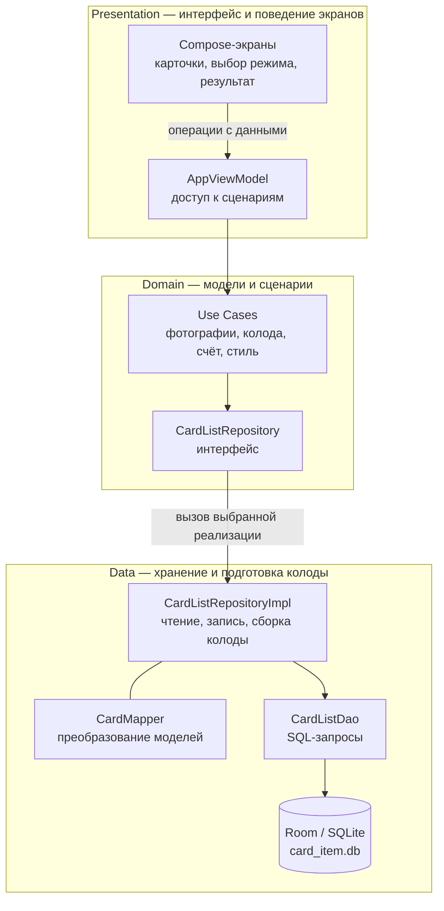
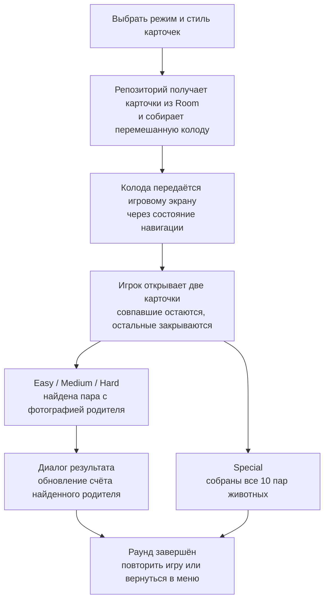

<div align="center">

# Find The Parent

**Игра на память с фотографиями родителей**


[Скриншоты](#скриншоты) · [Как играть](#как-играть) · [Стек](#стек) · [Архитектура](#архитектура) · [Сборка](#сборка) · [Статус](#статус)

</div>

Личная Android-игра, которую я самостоятельно разработал для дочери на Kotlin и Jetpack Compose. Ребёнок открывает карточки с животными и ищет парные фотографии родителей. Вместо готовых персонажей можно выбрать собственные снимки с телефона.

## Скриншоты

<table align="center">
  <tr>
    <th width="33%">Главный экран</th>
    <th width="33%">Выбор режима</th>
    <th width="33%">Игровое поле</th>
  </tr>
  <tr>
    <td align="center"><a href="https://github.com/user-attachments/assets/b0e18c91-ed58-44d9-9367-0f9ee70dd916"></a></td>
    <td align="center"><a href="https://github.com/user-attachments/assets/4559d113-e17b-45e9-807c-1c5647b97acd"></a></td>
    <td align="center"><a href="https://github.com/user-attachments/assets/12bcb5ad-65c3-4766-a1d7-87fb4ea00be3"></a></td>
  </tr>
</table>

<details>
<summary>Дополнительные экраны</summary>

<table align="center">
  <tr>
    <th width="50%">Заставка</th>
    <th width="50%">Панель настроек</th>
  </tr>
  <tr>
    <td align="center"><a href="https://github.com/user-attachments/assets/b008d516-5eeb-4c27-9418-83323b184d38"></a></td>
    <td align="center"><a href="https://github.com/user-attachments/assets/9485f1bd-dd7f-4ae7-a134-1339d212bb64"></a></td>
  </tr>
  <tr>
    <th>Вариант экрана выбора</th>
    <th>Поиск пар</th>
  </tr>
  <tr>
    <td align="center"><a href="https://github.com/user-attachments/assets/16d0f6f5-7b62-435d-b663-51d10d60a29e"></a></td>
    <td align="center"><a href="https://github.com/user-attachments/assets/7bc787fb-c5d8-42e2-aa7e-4955a965fe77"></a></td>
  </tr>
</table>

</details>

## Как играть

1. На главном экране выбрать фотографии родителей и нажать «Начать».
2. Выбрать режим и открывать карточки по две: совпавшие остаются открытыми, остальные закрываются.
3. В обычных режимах найти пару с фотографией родителя, чтобы завершить раунд. В Special — собрать все пары животных.

| Режим | Карточки | Поле | Задача |
| --- | ---: | --- | --- |
| Easy | 12 | 3 колонки | Найти пару родителей |
| Medium | 16 | 4 колонки | Найти пару родителей |
| Hard | 20 | 4 колонки | Найти пару родителей |
| Special | 20 | 4 колонки | Собрать 10 пар животных, без фотографий родителей |

Можно выбрать один из трёх стилей карточек. Фотографии, выбранный стиль и счёт родителей сохраняются на устройстве; сервер, аккаунт и API-ключи для игры не нужны.

## Стек

| Область | Технологии | Применение в проекте |
| --- | --- | --- |
| Язык | Kotlin 1.8.10 | Модели карточек, сценарии приложения и игровое поведение |
| Интерфейс | Jetpack Compose, Material 3 | Главный экран, выбор режима, карточки, боковая панель и диалог результата |
| Состояние и навигация | Compose State, StateFlow | Состояние карточек в Compose; стиль и переключение экранов через StateFlow и собственный `AppNavigationScreens` |
| Доступ к сценариям | AndroidX ViewModel 2.6.2, Use Cases | `AppViewModel` предоставляет экрану операции получения колоды, фотографий, счёта и настроек |
| Асинхронная работа | Coroutines 1.6.4 | Чтение и запись локальных данных через `suspend`-операции |
| Хранение | Room 2.5.2, SQLite | Карточки, пути к фотографиям, счёт родителей, выбранный стиль и состояние первого запуска |
| Зависимости | Dagger 2.43.2 | Привязка репозитория, предоставление DAO и создание ViewModel через фабрику |
| Фотографии | Activity Result API, Coil 2.1.0 | Системный выбор снимка, копирование в папку приложения и отображение по локальному URI |
| Генерация кода | kapt, KSP | Генерация компонентов Dagger и реализации Room |

## Архитектура

Код разделён на **presentation, domain и data**. Экраны обращаются к операциям через `AppViewModel`, сценарии используют контракт репозитория, а реализация работает с локальными данными и собирает игровую колоду.

### Слои и путь обращения к данным



Dagger связывает `CardListRepository` с реализацией и создаёт `AppViewModel` через фабрику. Навигация хранит текущий экран в StateFlow; `MainActivity` наблюдает за ним через `collectAsState` и показывает нужный Compose-экран.

| Компонент | Ответственность |
| --- | --- |
| [Экраны и AppViewModel](app/src/main/java/com/kuvalin/findtheparent/presentation) | Взаимодействие с пользователем и вызов сценариев. Проверка пар, открытые карточки и завершение раунда находятся в `Game.kt` |
| [Модели и сценарии](app/src/main/java/com/kuvalin/findtheparent/domain) | `Card`, `Score`, операции чтения и сохранения, контракт `CardListRepository` |
| [Репозиторий и преобразования](app/src/main/java/com/kuvalin/findtheparent/data) | `prepareCollection` собирает колоду для режима; `CardMapper` преобразует модели приложения и Room |
| [Сборка зависимостей](app/src/main/java/com/kuvalin/findtheparent/di) | Компонент приложения, привязка репозитория, DAO и фабрика ViewModel |

### От выбора режима до результата



| Данные | Как проходят через приложение |
| --- | --- |
| Фотографии родителей | Системный выбор снимка → копия во внутренней папке приложения → сохранение локального URI через сценарий и репозиторий. **В Room хранится путь, изображение остаётся файлом**; Coil загружает его для меню и карточек |
| Колода и ход игры | Режим и стиль → `GetCardListUseCase` → `prepareCollection` → готовый список карточек. Колода и открытые карточки текущего раунда находятся в памяти |
| Счёт | После найденной пары родителя диалог получает сохранённый счёт и увеличивает соответствующее значение. `AddGameScoreUseCase` записывает результат при выборе «Заново», «Меню» или закрытии диалога; Special счёт родителей не меняет |
| Выбранный стиль | Изменение отображается через StateFlow и сохраняется в Room для следующих запусков |

## Сборка

Приложение рассчитано на **Android 8.0 и новее**. Для сборки исходников нужны Android Studio, Android SDK 33 и JDK 17 для запуска Gradle. В проекте также задана Java toolchain 8 — для компиляции должен быть доступен JDK 8.

<details>
<summary>Сборка и запуск из исходников</summary>

1. Клонировать репозиторий и открыть его корень в Android Studio.
2. Выбрать JDK 17 в настройках Gradle JDK, установить SDK 33 и предоставить JDK 8 как toolchain.
3. Дождаться синхронизации Gradle, выбрать устройство или эмулятор с API 26+ и запустить конфигурацию `app`.

Сборка debug APK из PowerShell:

```powershell
git clone https://github.com/Vkuvalin/FindTheParent.git
cd FindTheParent
.\gradlew.bat :app:assembleDebug
```

APK: `app/build/outputs/apk/debug/app-debug.apk`.

Исходная конфигурация: Gradle 8.0, Android Gradle Plugin 8.1.2, Kotlin 1.8.10, compile/target SDK 33. Совместимость сборки с текущим окружением в этом проходе не проверялась.

</details>

## Статус

Разработка остановлена. Это самостоятельный личный Android-проект с реализованным игровым циклом, выбором фотографий и локальным хранением данных.

Часть переключателей в панели настроек осталась заготовкой: они меняют положение в интерфейсе, но не влияют на поведение игры.
